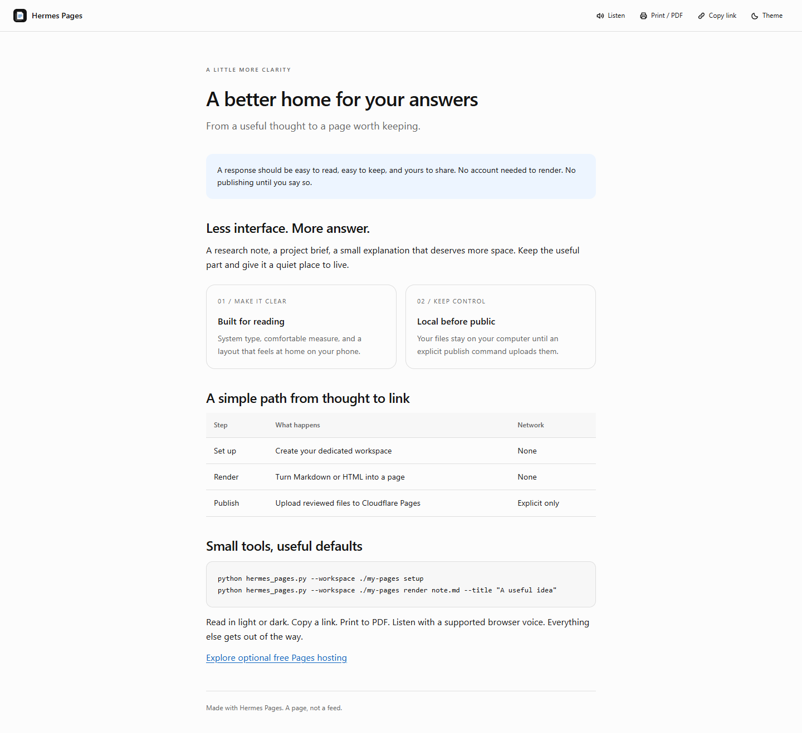
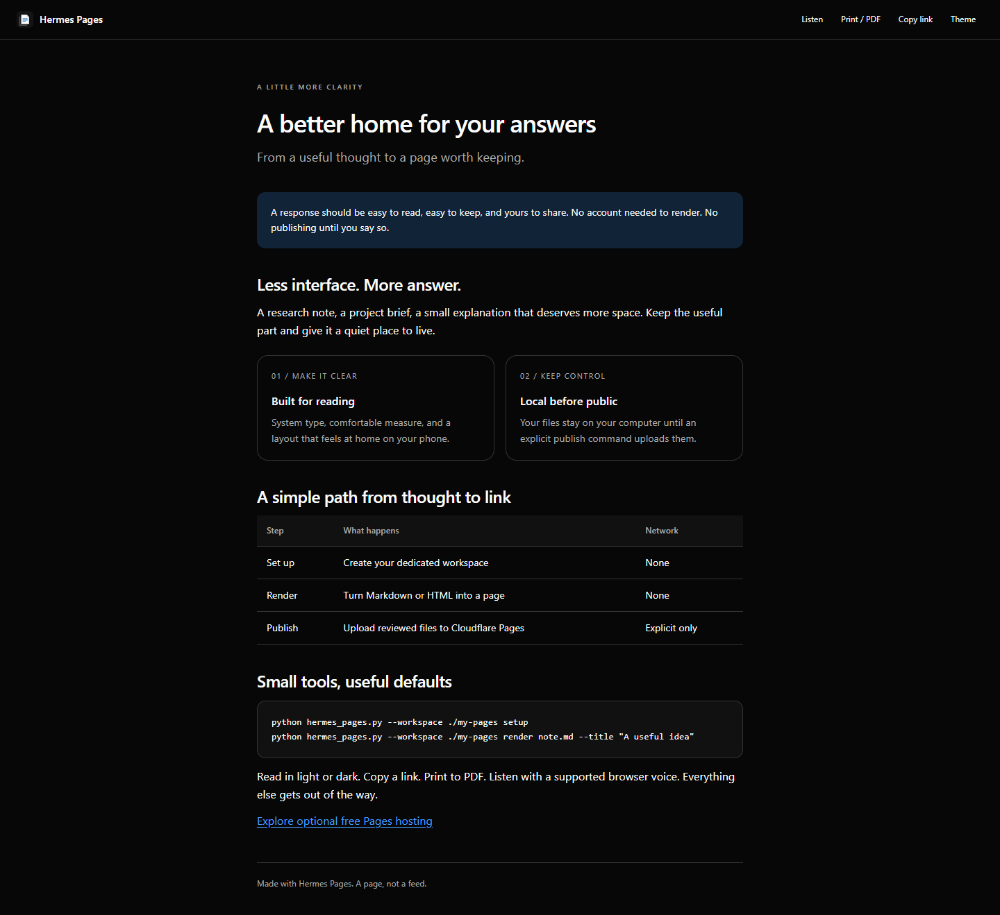
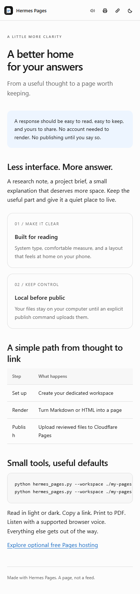

# Hermes Pages for Hermes Agent


Turn Markdown or trusted HTML from [Hermes Agent](https://github.com/NousResearch/hermes-agent)
into clean, responsive pages with a quiet reading layout. Rendering is offline and uses only
Python's standard library. Publishing happens only when you ask for it, with optional free
Cloudflare Pages hosting on an included `pages.dev` address.

- a 700px reading column, or a 1280px wide layout
- sticky action bar, title, summary, date and tag chips, tables, code, cards and callouts
- light and dark mode that follows the system, with a saved override
- Copy link, Print / Save as PDF and optional browser-voice Listen
- a local page library with deterministic slugs and explicit updates
- no required API keys, paid services, CDNs, external fonts or runtime packages

| Light | Dark | Phone |
| --- | --- | --- |
|  |  |  |

Screenshots are real captures from local headless Microsoft Edge using the bundled generic
sample. This is a community plugin, not an official Nous or Cloudflare product.

## Install

```bash
hermes plugins install kenhendricks00/hermes-pages-plugin --enable
```

This is a [Portable Agent Plugins v1](https://agent-plugins.org/specification) package with one
skill and its script. It registers no agent tools, hooks,
services or secrets, and has no install script or install-time network behavior. Python 3.10+ is
needed for the script. Start a new session after installing so the skill shows up.

A catalog entry has been submitted but is not listed yet, so `hermes plugins install hermes-pages`
only works once a maintainer merges it.

## Usage

Ask Hermes:

> Use Hermes Pages to render this note locally. Do not publish it yet.

Or run the script yourself from the repository root. Use a **new, dedicated** workspace, not an
existing website:

```bash
python skills/hermes-pages/scripts/hermes_pages.py --workspace ./my-pages setup
python skills/hermes-pages/scripts/hermes_pages.py --workspace ./my-pages render note.md \
  --title "A useful idea" --summary "The short version, before the detail." --slug useful-idea --tags notes,ideas
```

Open `my-pages/public/useful-idea.html` in your browser. Assets use relative paths, so local file
viewing works. Without `--workspace`, the default is `$HERMES_HOME/hermes-pages` (or
`~/.hermes/hermes-pages`). No Hermes settings are changed.

| Flag | Meaning |
| --- | --- |
| `--html` | Treat input as trusted HTML (not sanitized) |
| `--wide` | Use a 1280px content column |
| `--slug useful-idea` | 1-64 lowercase ASCII letters, digits or hyphens |
| `--tags a,b` | Tags shown as chips |
| `--date YYYY-MM-DD` | Date shown under the title (default today) |
| `--replace` | Intentionally update an existing managed page |

Input is a UTF-8 file or `-` for stdin. Repeating the exact same render is a no-op; a different
render to an existing slug needs `--replace`. `index` and `404` are reserved slugs. Setup can be
repeated without resetting pages. The manifest tracks SHA-256 hashes, and updates refuse edited
managed files and unmanaged files. Unrelated workspace files are preserved and never uploaded.

The built-in Markdown is a small subset (headings, one-line paragraphs, flat lists, blockquotes,
fenced and inline code, bold, links, simple pipe tables), **not CommonMark**. Raw HTML is escaped
in Markdown. For richer layouts use trusted HTML with the `grid`, `card` and
`callout info|warning|success|danger` classes; wrap large tables in `.table-wrap` and use `.num`
for right-aligned numbers.

## Optional free Cloudflare Pages hosting

Rendering needs no account. To host, create a free Cloudflare account and a **new, dedicated**
Direct Upload Pages project. The `pages.dev` address is included; a custom domain is optional and
may cost money.

1. Use an existing Wrangler, or install it yourself following
   [Cloudflare's guide](https://developers.cloudflare.com/workers/wrangler/install-and-update/).
   This plugin never installs packages or runs `npx` downloads.
2. Run `wrangler login` in your own terminal. Never paste tokens into chat.
3. `wrangler pages project create YOUR-NEW-PROJECT --production-branch main`
4. Review every page and the public index, then preview the upload:

   ```bash
   python skills/hermes-pages/scripts/hermes_pages.py --workspace ./my-pages publish --project YOUR-NEW-PROJECT --dry-run
   ```

5. Publish only when ready to make the whole library public:

   ```bash
   python skills/hermes-pages/scripts/hermes_pages.py --workspace ./my-pages publish --project YOUR-NEW-PROJECT --confirm-public
   ```

   Add `--wrangler /path/to/wrangler` if it is not on PATH.
6. Open the exact URL Wrangler reports and check the page before sharing. A successful exit is not
   proof the live URL works.

The publisher stages only hashed managed public files in a fresh temporary folder and runs
Wrangler with `shell=False` and a 180-second timeout. It uploads to the exact project you name, so
naming an existing project replaces that project's deployment. It does not touch DNS, create paid
resources or configure access control. It never starts a login; if Wrangler prompts or stalls, it times out. Dashboard
drag-and-drop of the reviewed `public` folder into a new project also works
([Direct Upload docs](https://developers.cloudflare.com/pages/get-started/direct-upload/)).

**The free tier is not unlimited.** See
[Cloudflare's current limits](https://developers.cloudflare.com/pages/platform/limits/): for
example 20,000 files per site, 25 MiB per asset, 500 builds a month and deployment retention
rules. Recheck before relying on them.

## Safety

- **Publishing is explicit.** Nothing is uploaded unless you run `publish` with
  `--confirm-public`. There are no automatic, scheduled or background uploads.
- **Trusted HTML is not sanitized.** `--html` input is treated as authorized by you. Do not pass
  scraped or third-party HTML without review; it can change page structure or run code when the
  file is opened locally. The default `_headers` CSP is defense in depth, not a sanitizer, and does
  not apply to local file viewing.
- **Public means public.** The library and JSON index are public once published. Random slugs are
  not passwords, and there is no built-in authentication.
- **Wrangler OAuth is yours.** Login is a user action on Cloudflare's own screen. This plugin never
  reads, refreshes or stores credentials or Wrangler token files.
- **Deleting local files does not remove hosted copies.** Use Cloudflare's deployment management.
  There is no delete, purge or rollback command.

## What this plugin does and touches

- **Files.** Setup and render read bundled assets and your input, and write only the chosen
  workspace. Writes use a lock and per-file atomic replacement; they are not a multi-file
  transaction if the process or disk fails mid-write, and a stale lock or hash mismatch fails
  closed. Symlinks are unsupported. The only environment value read is `HERMES_HOME`.
- **Network.** Setup and render make no network calls. Publish runs your Wrangler, which contacts
  Cloudflare to upload every managed public page, the index and shared assets. Listen uses the
  browser's speech engine, which may use a network voice service.
- **Browser.** The theme choice is stored in localStorage. Copy uses the clipboard only on a click.
- **No telemetry,** analytics, tracking pixels, external CDNs, runtime installs or self-updater.

A read-only Hermes Desktop library for your pages is in progress on the
[`feat/desktop-sidebar`](https://github.com/kenhendricks00/hermes-pages-plugin/tree/feat/desktop-sidebar)
branch and is not part of this release.

## Develop

```bash
git clone https://github.com/kenhendricks00/hermes-pages-plugin
cd hermes-pages-plugin
python -m unittest discover -s tests -v
hermes plugins validate . --install-deps
# Optional developer-only checks using an existing local Playwright and Microsoft Edge:
python tests/browser_check.py
python tests/make_assets.py
```

The renderer and unit tests need only stdlib. Wrangler runs are mocked subprocess tests; no live
deployment is claimed. `browser_check.py` covers content, the 700px column, theme persistence,
Copy, Print, print CSS, real PDF bytes, phone overflow and the unsupported-speech fallback, and
refreshes the screenshots. `make_assets.py` rebuilds the icon PNGs and the banner from a real
rendered sample page. Neither downloads browsers or uses remote rendering. Audible voice playback
is not verified. Release steps are in
[maintenance.md](skills/hermes-pages/references/maintenance.md).

## More cards

Each works on its own; together they bring Grok Bot style inline cards to Hermes.

- [Order Cards](https://github.com/kenhendricks00/hermes-order-cards): approve checkouts before anything is bought.
- [Send Cards](https://github.com/kenhendricks00/hermes-send-cards): read and edit every message draft before it is sent.
- [Weather Cards](https://github.com/kenhendricks00/hermes-weather-cards): real forecasts you can read at a glance.
- [Input Cards](https://github.com/kenhendricks00/hermes-input-cards): give your agent an API key through Hermes's secure prompt.
- [Hermes Pages](https://github.com/kenhendricks00/hermes-pages-plugin) (this one): turn useful answers into clean, shareable pages.

## License

MIT, see [LICENSE](LICENSE).
