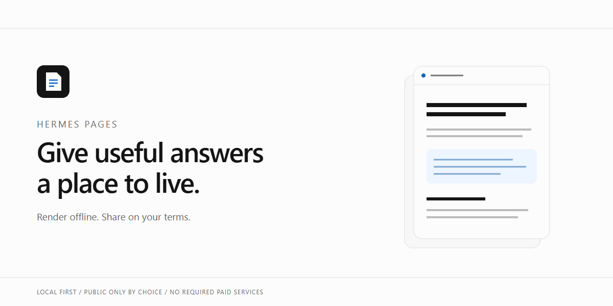
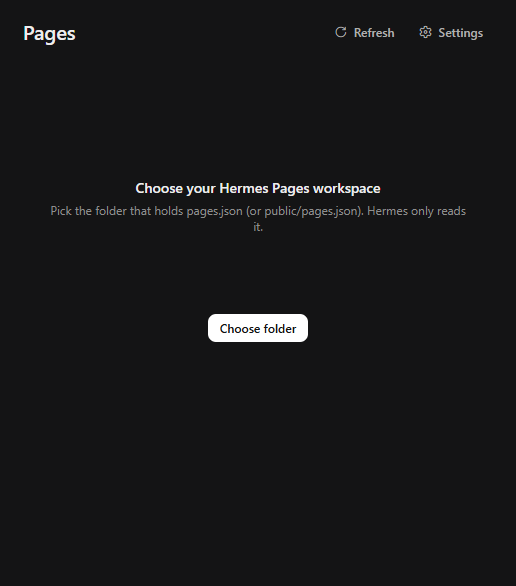

# Hermes Pages

**Give useful answers a place to live.**

Turn Markdown or trusted HTML into clean, responsive pages with a quiet reading layout. Render offline with Python's standard library. Publish only when you choose, using optional free Cloudflare Pages hosting and an included `pages.dev` address.

This is a community plugin for Hermes Agent, not an official Nous or Cloudflare product. Original page icon and banner, no vendor-lookalike branding. The reading layout takes inspiration from the neutral, system-font response-page style, with an original implementation and generic sample content.

## What you get

- A 700px reading column or optional 1280px wide content layout.
- Sticky action bar, title and summary, tables, code, cards and callouts.
- System-aware light/dark mode with a saved browser override.
- Copy link, browser Print / Save as PDF, optional browser-voice Listen.
- A local page library, deterministic slugs and explicit managed-page updates.
- Dedicated-workspace setup that refuses to overwrite unmanaged files.
- Explicit, hash-checked, managed-only publishing. No automatic uploads.
- No required API keys, paid services, CDNs, external fonts or runtime packages.


[Dark mode](docs/dark.png) · [Phone layout](docs/phone.png)

Screenshots are real captures from local headless Microsoft Edge, using only generic fixtures. No hosted browser credits or remote rendering services were used.

## Install in Hermes

Requires Hermes with portable Agent Plugins v1 support. The catalog submission declares `>=0.21.6`; Python 3.10+ is needed for the utility. Windows, macOS and Linux are supported by the source; the executed checks for this release were on Windows 11.

```sh
hermes plugins install https://github.com/kenhendricks00/hermes-pages-plugin
```

Review Hermes's installation scan and approve the install. Restart or reload skills as your Hermes version supports. Ask: "Use Hermes Pages to render this note locally. Do not publish it yet."

**Catalog status:** prepared for submission, not yet listed. After a maintainer merges the catalog entry, installation by `hermes plugins install hermes-pages` becomes available. This README does not claim a current Marketplace listing.

This is a portable Agent Plugins v1 package (`plugin.json`, `skills/`, and an optional `desktop/plugin.js`). It registers no agent tools, hooks, middleware, services or environment secrets. There is no install script and no install-time network/auth/deploy behavior in this package.

## Desktop sidebar

On supported Hermes Desktop builds, the optional desktop half adds a **Pages** sidebar row (book icon), the `/pages` library page, and an **Open Pages** palette command. The library has a responsive card grid, bold titles, two-line summaries, dates and tag chips. It shows four recent pages first, then month groups, newest first. Search matches titles, tags, summaries and slugs. Refresh reloads the index, and React Query refetches stale data on window focus without a polling loop.

1. Install this branch/package in Desktop. Unified-package installs are **opt-in**: turn on **Hermes Pages** in **Capabilities > Plugins**. A manually installed standalone `desktop-plugins/hermes-pages/plugin.js` uses the SDK's enabled-by-default disk-plugin behavior; an explicit previous off choice is always honored.
2. Open **Pages**, use the command palette's **Open Pages** command, or **Settings > Plugins > Hermes Pages > Open Pages**. Custom sidebar replacements can hide the app's navigation rows; the palette command and settings entry remain available. The SDK's sidebar payload has no child-item API, so recent pages stay in the library rather than being injected into another plugin's sidebar.
3. Choose your workspace through the app's folder picker. The grant and selected handle are remembered and revocable in **Capabilities > Plugins > Folder access**. Both `public/pages.json` and root `pages.json` layouts are supported, including older entries with `created` dates and `pages/<slug>.html` files. The folder is read-only from this plugin.
4. Use **Settings** on the library page to change folders or optionally save a published base URL, for example `https://my-pages.pages.dev`. It is stored only in plugin-scoped storage. A root-site index may supply a safe relative `path`; otherwise the plugin looks for `<slug>.html`, then `pages/<slug>.html`.

A click opens a full-width reading view inside the Hermes workspace using the SDK's `SandboxedFrame`. The local view inlines stylesheets and up to 24 images from the granted folder into a data document, strips scripts, and blocks external subresources and active scripts with a restrictive policy. This is a static reading view: page action bars, external images, audio, relative links and other interactive content may not work. With a saved base URL, **Published** shows the live page in the sandbox and **Open in browser** opens its address with the SDK OS helper. Some hosts refuse framing; the browser button is the fallback. An older Desktop without `SandboxedFrame` also offers the browser fallback. **Show file** reveals only a file found inside the granted workspace. It does not edit or open arbitrary filesystem paths.

**File-access boundary:** Desktop refuses grants inside Hermes's own data directory. For Desktop browsing, choose a dedicated workspace outside `$HERMES_HOME`, for example `~/my-pages`. Do not move or overwrite an existing personal site just to use the utility. Kenneth's existing `C:/Users/Kenneth/hermes-pages` can be selected read-only; setup/render should still use a separate new workspace.

**Desktop capabilities and disclosure:** contributes a route, sidebar row and palette commands; requests folder access only on a user gesture; reads the index, HTML and referenced local assets through `ctx.files`; stores its folder handle and optional site URL through `ctx.storage`; can reveal a resolved page path, copy a link or open a published URL only after a click. No `preview.executeJavaScript` capability, raw native bridge, shell process, polling timer, upload, telemetry, credential read or backend dependency. The Published view and browser fallback contact the saved site and whatever that site loads. Local-page hyperlinks may navigate the sandbox when clicked. No install-time network behavior is added.

The layout follows Hermes theme variables. The standalone file is plain ESM with only SDK and React imports, no JSX or build step. The desktop half is discovered by its conventional `desktop/plugin.js` path, like other Portable Agent Plugins v1 packages; no nonstandard `desktop` manifest field is required.

Desktop verification for this branch: static checks and package validation passed. An SDK-mock Node harness read a real root-layout index (46 entries, all 46 files found) without changing it, and a freshly rendered scratch `public/` workspace. A background-only capture of the actual Windows Hermes Desktop confirmed the plugin enabled, its settings page rendered, and `/pages` displayed the first-run folder chooser. A populated library and inline reader have not yet been verified in-app because the user must grant the folder. The installed Monograph skin hides the core sidebar navigation group, so its Pages row was not visible there; no other plugin was modified to force it into view.



This is a cropped capture of the real Desktop route before folder access is granted, not a library mockup.

## Use without Hermes

Clone the public repository or use the script in the installed skill. These examples run from the repository root. Choose a **new dedicated** workspace, not an existing website.

```sh
python skills/hermes-pages/scripts/hermes_pages.py --workspace ./my-pages setup
python skills/hermes-pages/scripts/hermes_pages.py --workspace ./my-pages render note.md \
  --title "A useful idea" --summary "The short version, before the detail." --slug useful-idea --tags notes,ideas
```

Open `my-pages/public/useful-idea.html` directly in your browser. All page assets use relative paths so local file viewing works. No network is needed for setup or rendering. The default workspace, if omitted, is `$HERMES_HOME/hermes-pages`, or `~/.hermes/hermes-pages` without that variable. No Hermes settings are changed.

Input can be a UTF-8 file or `-` for stdin. Optional flags:

| Flag | Meaning |
| --- | --- |
| `--html` | Treat input as authorized, trusted HTML, not sanitized HTML |
| `--wide` | Use a 1280px content column |
| `--slug useful-idea` | 1-64 lowercase ASCII letters, digits or hyphens |
| `--replace` | Intentionally update an existing managed page |

Exact repeats of the same render are idempotent. A different render to an existing slug needs `--replace`. Slugs are derived from the title if omitted; titles without ASCII letters/digits need an explicit slug. `index` and `404` are reserved.

Setup can be repeated without resetting pages. The manifest tracks SHA-256 hashes; updates refuse edited managed targets as well as unmanaged targets. Use the CLI, rather than hand-editing output. Unrelated workspace files are preserved and never selected for CLI upload. Keep original inputs outside `public`.

### Markdown and HTML

The built-in Markdown subset includes headings, one-line paragraphs, flat lists, blockquotes, fenced code, inline code, bold, HTTP(S)/mailto links and simple pipe tables. It is **not CommonMark**: nested lists, multi-line paragraphs, images, reference links, syntax highlighting and complex pipe escaping are not implemented. Raw HTML is escaped in Markdown.

Use trusted HTML for richer layouts:

```html
<div class="grid">
  <section class="card"><h3>A clear next step</h3><p>One useful point.</p></section>
  <section class="card"><h3>Something to keep</h3><p>One useful reference.</p></section>
</div>
<div class="callout info">A short, important note.</div>
```

Other callout classes: `warning`, `success`, `danger`. Wrap large HTML tables in `.table-wrap`; use `.num` for right-aligned numbers.

**Trust model:** `--html` is user-authorized source and is not sanitized. Do not pass untrusted scraped HTML or content from another person without review. Metadata is escaped and substitution is single-pass, but malicious authorized HTML can change page structure or run code during local file viewing. Default Cloudflare `_headers` restrict scripts to local sources, disallow embeds and outbound connections, and set no-referrer/nosniff headers. These are defense in depth, not a sanitizer. Local file viewing does not apply HTTP headers. Externally hosted images/scripts are intentionally blocked by the default hosting CSP.

## Optional free Cloudflare Pages hosting

No account is needed to render. For hosting, create a free Cloudflare account and use a **new dedicated Direct Upload Pages project**. Do not use an existing personal site. The included `pages.dev` address does not require a domain purchase. A custom domain is optional and registration may cost money.

1. Use an existing Wrangler executable. If missing, manually approve a local installation following [Cloudflare's official guide](https://developers.cloudflare.com/workers/wrangler/install-and-update/). This utility never installs packages, runs npx downloads, or changes global CLI settings.
2. In your own interactive terminal, run `wrangler login` and complete Cloudflare's user-owned OAuth screen. Never paste tokens into chat. Wrangler owns its credentials; this plugin never reads its token files.
3. Explicitly create a new static project:

   ```sh
   wrangler pages project create YOUR-NEW-PROJECT --production-branch main
   ```

4. Review **all pages and the public index**, not just the last page. Preview the exact upload selection:

   ```sh
   python skills/hermes-pages/scripts/hermes_pages.py --workspace ./my-pages publish \
     --project YOUR-NEW-PROJECT --dry-run
   ```

5. Only when ready to make the library public:

   ```sh
   python skills/hermes-pages/scripts/hermes_pages.py --workspace ./my-pages publish \
     --project YOUR-NEW-PROJECT --confirm-public
   ```

   Add `--wrangler /path/to/existing/wrangler` if it is not on PATH.

6. Use the exact deployment URL Wrangler reports. Fetch it and verify the page title, assets and content before sharing. The desired hostname can receive a suffix if already taken. A successful subprocess exit is not live-URL verification.

Publisher uses a subprocess argument list with `shell=False`, a 180-second timeout and a fresh isolated working directory. It stages only hashed managed public assets, so nearby Functions, Worker entrypoints, source files, unrelated public files and credentials cannot accidentally be uploaded. It does not modify DNS, create paid resources or configure access control. It uploads to the exact project you name, so naming an existing project would intentionally replace that project's deployment. Choose a new project and retain its name separately.

OAuth remains a user action, not an automated onboarding promise. In unattended runs, do not start login; prepare local files or fail cleanly. If Wrangler prompts or stalls, the publisher times out instead of waiting forever.

Dashboard drag-and-drop is an alternative; drop only the reviewed `public` folder into a **new** Pages project. This manual route uploads all files you drop. [Direct Upload documentation](https://developers.cloudflare.com/pages/get-started/direct-upload/). Direct Upload projects cannot later switch to Git integration.

### Free tier is not unlimited

[Current Cloudflare limits](https://developers.cloudflare.com/pages/platform/limits/) list 500 builds/month, one concurrent build, 20,000 files/site on Free, 25 MiB per asset, and a soft 100-project account limit. Dashboard drag-and-drop supports 1,000 files; Wrangler supports 20,000. Direct Upload sends prebuilt files and does not run a hosted build; do not equate the build allowance with an upload guarantee. Deployments have retention rules: 30 days, with the most recent 100 and current production deployment retained. Recheck the official docs before relying on limits. No Functions or Workers bindings are used here; those have separate quotas if you add them.

## Privacy, security and disclosures

- Installation has no executable side effects. Setup/render read bundled assets and the user-selected input and write only the selected workspace. The only environment setting the utility reads is the nonsecret `HERMES_HOME` path.
- Publishing invokes the explicitly selected existing Wrangler CLI, which uses its own account OAuth and contacts Cloudflare to upload **every managed public page**, the index and shared assets. The utility does not inspect, refresh or store credentials and does not call private APIs. The user's CLI may itself write logs/cache as documented by Cloudflare.
- No telemetry, analytics, tracking pixels, external CDN, background server or scheduled publishing. Tests temporarily run a loopback-only HTTP server that is shut down on completion.
- Browser theme preference is stored in localStorage. Copy uses the browser clipboard only on a click. Print uses the browser print dialog. Listen depends on browser/OS voice availability; browser vendors may use network speech services. A local voice is preferred when available, not guaranteed. Unsupported/empty voice environments show an honest fallback.
- HTML input is trusted, not sanitized. Untrusted HTML must be reviewed separately. Public URLs are not passwords. The library and JSON index are public. Random slugs do not protect sensitive documents.
- No built-in authentication. Optional Cloudflare Access or another authenticated host is a separate configuration with its own limits/pricing. Verify every URL, including the default hostname, before considering private use.
- Removing local files does not erase older hosted deployments or copies. Use Cloudflare's deployment management for removal. This release has no delete command, remote purge or automatic rollback.
- Workspace writes use a lock and per-file atomic replacement with preflight checks. They are **not** a multi-file transaction if the process or disk fails mid-write. A stale lock or hash mismatch fails closed; inspect/back up before recovery. Symlinks are unsupported. The manifest is trusted local state, not a boundary against an attacker who can edit your workspace.
- No runtime dependency installation, core patches, token scraping, credential-store reads or self-updater. Plugin updates use reviewed repository/catalog commits.

## Tests and current verification

```sh
python -m unittest discover -s tests -v
hermes plugins validate . --install-deps --json
```

At release: 34 unit tests run, 33 passed, one OS-dependent symlink creation test skipped on Windows. Rendering, escaping, paths, idempotence, safe overwrite refusal, real CLI processes/errors, profile paths and upload selection are exercised. Wrangler execution/success/failure checks are **mocked subprocess tests**, not a live deployment. No Wrangler executable was available on PATH, so no Cloudflare resources were created and no live deployment URL is claimed.

Optional developer-only browser check, with an already installed Playwright and local Microsoft Edge:

```sh
python tests/browser_check.py
```

The actual local check passed for desktop content, 700px reading width, theme toggle/persistence, Copy feedback, Print action, print CSS, actual PDF bytes, phone overflow and unsupported speech fallback, with no page errors. Audible voice playback is not verified. Playwright is not a runtime dependency and the browser test does not download browsers. See [release workflow](skills/hermes-pages/references/maintenance.md).

## Layout

```text
plugin.json
desktop/plugin.js         Optional Desktop library, route, sidebar and commands
skills/hermes-pages/
  SKILL.md
  scripts/hermes_pages.py
  assets/                 Original theme, template, JS, icon and generic sample
  references/             Hosting and release workflows
tests/                    Offline tests and optional local-browser checks
docs/                     Original banner and actual screenshots
```

MIT licensed. Contributions should keep the offline stdlib path, explicit publication boundary, public APIs and portable profile-safe behavior intact.
